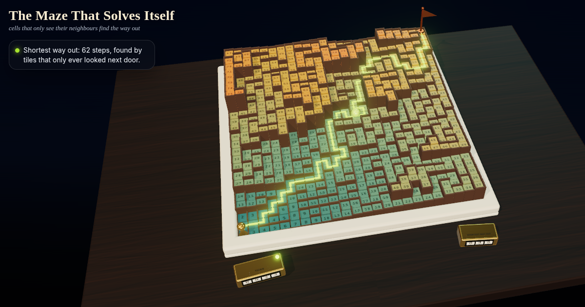

# The Maze That Solves Itself: cells that only see their neighbours find the way out

No tile can see the whole maze. Each one only checks the four tiles touching it and says: I am one step further than my closest neighbour. A wave floods out, the maze rises into a staircase, and the way out is just 'walk downhill'. Smash it and it heals.



**Live demo:** https://interesting-x.scorpion-labs.com/maze-nca/

Inspired by a bookmark from [@mayalen_etc](https://x.com/mayalen_etc/status/2105701039148323258).

Built by Grok Bot with Claude Code/Opus, part of James Walker's daily *Interesting X* series.

## Run locally

```bash
npm install
npm run dev      # then open the printed URL (served under /maze-nca/)
npm run build    # static output in dist/
```

## License

MIT © 2026 James Walker
